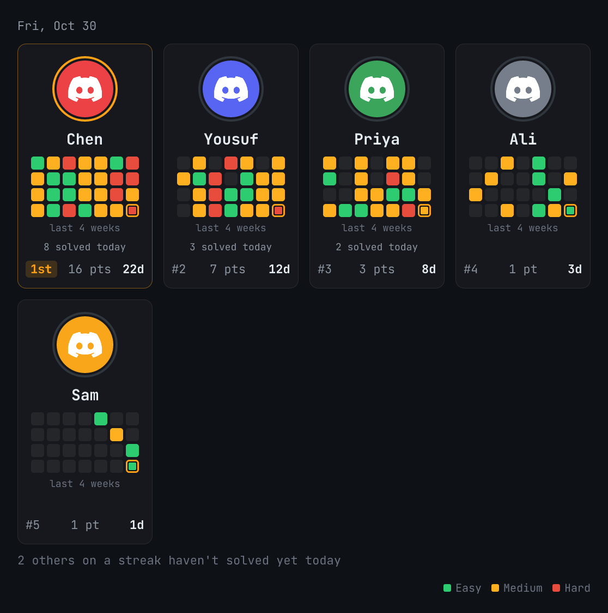
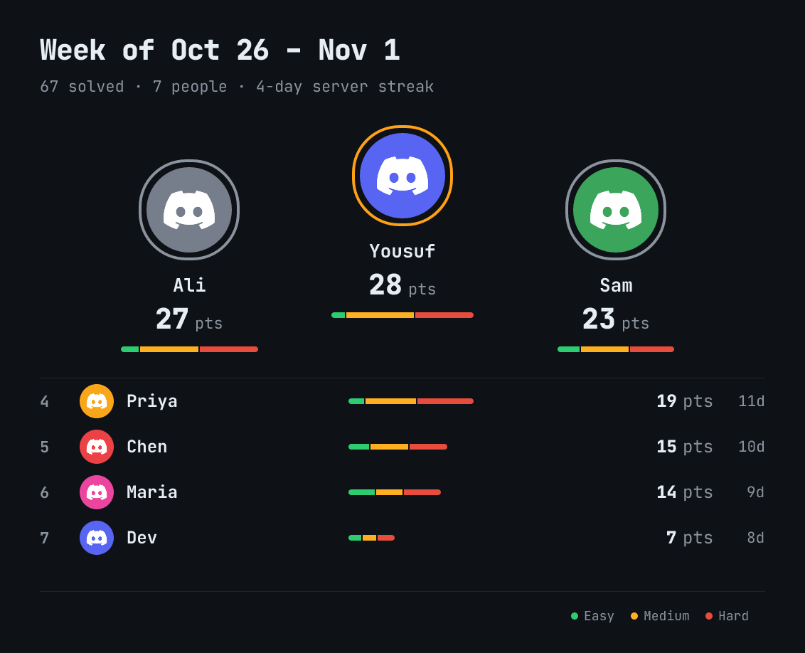
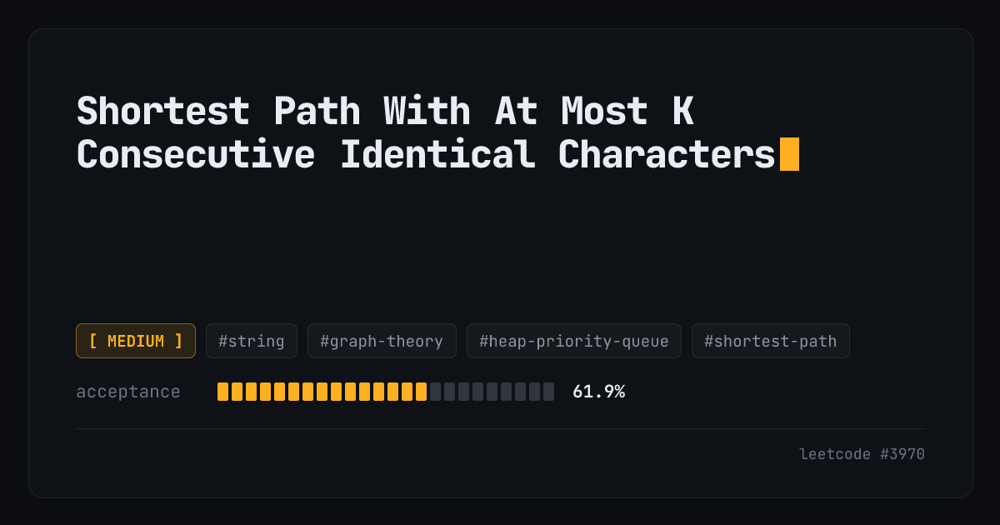

  

<h1 align="center">flow</h1>

A Discord bot for grinding LeetCode with your friends.

  <a href="https://discord.com/oauth2/authorize?client_id=1424614581355155568&permissions=536923136&scope=applications.commands+bot">Add to Discord</a>
  •
  <a href="https://flowbot.fyi">Website</a>
  •
  <a href="#commands">Commands</a>
  •
  <a href="#how-its-built">How it's built</a>

---

Link your LeetCode account and flow keeps track of what you solve. Every day your server gets a live board of who solved what, there's a leaderboard for the week, and `/next` always has a problem ready from whatever list you're working through.

## Features

- Live daily board that updates as people solve
- Weekly recap and leaderboards (week, month, all time)
- Study lists: NeetCode 150, Blind 75, Grind 75, LeetCode Top 150
- Streaks, with one free missed day a month
- Read the problem and the starter code without leaving Discord
- Import your past solves, not just new ones
- Optional morning reading list for the server (Hacker News, Reddit, X)
- Admins set everything up in one place with `/setup`

## Screenshots

## Commands

| Command | What it does |
|---|---|
| `/daily` | Today's LeetCode daily |
| `/next` | Next problem from your study list |
| `/random` | Random problem, by difficulty or topic |
| `/info` | Look up any problem |
| `/progress` | Your stats, streak and list progress |
| `/leaderboard` | Server leaderboard |
| `/link` | Connect your LeetCode account |
| `/import` | Import your full solve history |
| `/unlink` | Disconnect your account |
| `/setup` | Server settings (admins) |

## How it's built

The bot is written in Go and runs on Vercel as a single HTTP endpoint, so there's no always-on process. Discord only gives you 3 seconds to answer, which shaped a lot of it: every command has a time budget, and anything slow (like drawing images) happens outside the reply. Data lives in Supabase (Postgres), and the scheduled stuff (syncing solves, updating the board, the morning reads) runs on GitHub Actions.

The images are drawn by a small Node service with satori. Leaderboards are served from a signed URL, so Discord fetches the picture after the reply instead of waiting on it.

A few things I had fun figuring out:

- Importing history without ever touching your LeetCode login. A bookmarklet reads the list on leetcode.com and hands it over in the URL fragment, which browsers don't send to servers.
- Keeping the morning reads cheap. All the articles get scored once a day in one model call, and each server's picks come from plain code after that, so it costs the same for one server or a hundred.
- X Articles. For a while the bot found none at all. Turned out the search couldn't tell an article from a tweet, so it had to search for article links directly.

## About

I built flow for my own study group. The code is private for now, but if you want to know how something works, open an issue and ask.
